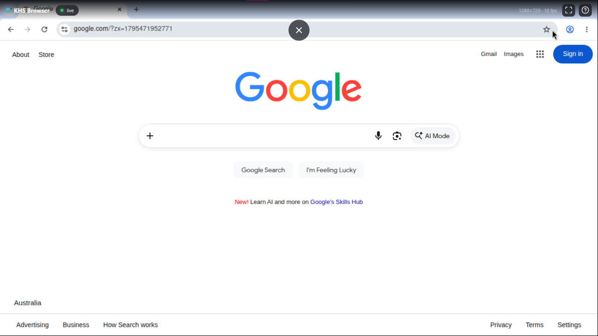

# khsbrowserwebui

A lightweight remote-browser web UI that runs anywhere Linux runs. It launches Chrome on a virtual display, streams the screen as JPEG frames over a WebSocket, and sends your mouse/keyboard back to it.

No WebRTC, no GStreamer, no firewall ports beyond HTTP — if you can reach an HTTP page, it works.



```
┌─────────────┐   JPEG frames over WebSocket   ┌─────────────┐
│   Chrome    │ ─────────────────────────────► │  your web   │
│  on Xvfb    │ ◄───────────────────────────── │  browser    │
└─────────────┘      mouse / keyboard JSON     └─────────────┘
```

---

## Quick start (any machine)

### 1. Get the code
```bash
git clone https://github.com/khssama/khsbrowserwebui.git
cd khsbrowserwebui
chmod +x run.sh
```

### 2. Install system dependencies (one time)
On Ubuntu/Debian:
```bash
sudo apt-get update
sudo apt-get install -y xvfb ffmpeg google-chrome-stable python3-pip
```

### 3. Start it
```bash
./run.sh --port 7071
```

It prints:
```
KHS Browser WebUI 0.1.0
  Local   : http://127.0.0.1:7071/
```

Open **`http://127.0.0.1:7071/`** in your browser. Click inside the stream and type — it controls the remote Chrome.

---

## Use it outside Kaggle

### A. From another device on the same Wi-Fi
Bind to all interfaces so other devices on your network can reach it:
```bash
./run.sh --host 0.0.0.0 --port 7071
```
Open `http://<this-machine-ip>:7071/` from your phone or laptop.

Add a firewall rule if needed:
```bash
sudo ufw allow 7071/tcp
```

### B. From anywhere over the internet (SSH tunnel — recommended)
Run the server bound to localhost only:
```bash
./run.sh --port 7071
```
From your **local computer**, create an encrypted tunnel:
```bash
ssh -L 7071:localhost:7071 user@your-server-ip
```
Then open `http://127.0.0.1:7071/` in your local browser. No extra server ports need to be open.

### C. Public URL without SSH (Cloudflare quick tunnel)
If you have `cloudflared` installed:
```bash
./run.sh --tunnel --token mysecret123
```
It prints a URL like `https://abc123.trycloudflare.com`. Open it and add `?token=mysecret123`.

---

## Full options

```bash
./run.sh [options]

--port 7071             port to listen on
--host 127.0.0.1        bind address (use 0.0.0.0 for network access)
--display :99           X virtual display number
--width 1280            virtual screen width
--height 720            virtual screen height
--fps 15                capture frame rate
--quality 6             JPEG quality (2 = best, 31 = smallest)
--browser PATH          force a specific Chrome/Chromium binary
--profile DIR           browser profile (default: ~/.local/share/khsbrowserwebui/profile)
--chrome-debug-port 0   Chrome DevTools port (0 = random)
--token SECRET          require ?token=SECRET to open the UI
--tunnel                start Cloudflare quick tunnel for a public URL
--tunnel-binary PATH    explicit cloudflared path
--check                 check system dependencies and exit
--fix                   auto-fix system issues and exit (agent mode)
--doctor                alias for --fix
--debug                 verbose logs
```

Examples:
```bash
# faster, smaller stream
./run.sh --width 1024 --height 640 --fps 12 --quality 8

# private server with a token
./run.sh --host 0.0.0.0 --port 7071 --token mysecret123

# auto-fix system and start (agent mode)
./run.sh --fix

# check what's missing without fixing
./run.sh --check
```

---

## Autonomous agent (default mode)

When you run `./run.sh`, khsbrowserwebui starts in **agent mode** — like a small AI agent that:

1. **Checks** your system (Python modules, system binaries, ffmpeg, browser)
2. **Fixes** anything missing automatically (installs packages via your package manager)
3. **Starts** a browser session (Xvfb + Chrome + capture + web server)
4. **Monitors** the session — if the browser or capture crashes, the agent re-diagnoses, re-fixes, and restarts automatically
5. **Keeps looping** until you press Ctrl+C

```bash
# Start in agent mode (default — self-heals forever)
./run.sh --port 7071

# Explicit agent mode
./run.sh --agent --port 7071

# Just check what's missing (no fixes, no start)
./run.sh --check

# Fix system issues and exit (don't start the browser)
./run.sh --fix

# Same as --fix
./run.sh --doctor
```

The agent will:
1. Check for Python modules (`aiohttp`, `python-xlib`)
2. Check for system binaries (`Xvfb`, `ffmpeg`, `chromium`)
3. Try to install anything missing via your package manager
4. Test if the browser can actually launch without crashing
5. Retry with different browser flags if needed
6. If the browser crashes while running, automatically heal and restart

---

## How to use the browser

1. Click anywhere inside the stream to focus it.
2. Type, click, paste — everything goes to the remote Chrome.
3. **F11** fullscreen, **Ctrl+L** address bar, **Ctrl+R** reload, **Ctrl+C / V** copy/paste.
4. Your session (cookies, bookmarks, logins) is saved in the profile folder and persists across restarts.

---

## Stop it

Press **Ctrl+C** in the terminal, or from another terminal:
```bash
pkill -f khsbrowserwebui
pkill -f "Xvfb :99"
```

---

## Requirements

- Linux
- `Xvfb`, `ffmpeg`, `google-chrome` (or Chromium)
- Python 3.9+, `aiohttp`, `python-xlib` (installed automatically by `run.sh`)

---

## Troubleshooting

**Browser crashes immediately**
```
./run.sh --check
```
This tells you what's missing. Common fix:
```bash
sudo apt-get install -y xvfb ffmpeg chromium-browser \
  libgbm1 libasound2 libatk1.0-0 libatk-bridge2.0-0 libcups2 \
  libdrm2 libxkbcommon0 libxcomposite1 libxdamage1 libxfixes3 \
  libxrandr2 libgdk-pixbuf2.0-0
```

**Port already in use**
```bash
./run.sh --port 7072
```

**Browser runs but screen is black**
Make sure Xvfb started. Check the log for `starting Xvfb on :NN`. If Xvfb
failed, install it: `apt-get install -y xvfb`.

**ffmpeg capture fails**
ffmpeg must be compiled with x11grab support. Check:
```bash
ffmpeg -demuxers | grep x11grab
```
If nothing shows, reinstall ffmpeg: `apt-get install --reinstall ffmpeg`.

**Can't focus the browser window (warning)**
This is normal on headless/Xvfb systems — there's no window manager. The
browser still receives input; just click inside the stream once.

**Permission denied running as root**
Chrome/Chromium refuses to run as root without `--no-sandbox`, which
khsbrowserwebui already passes. If you still get sandbox errors, create a
non-root user and run as that user.

## License

MIT License
